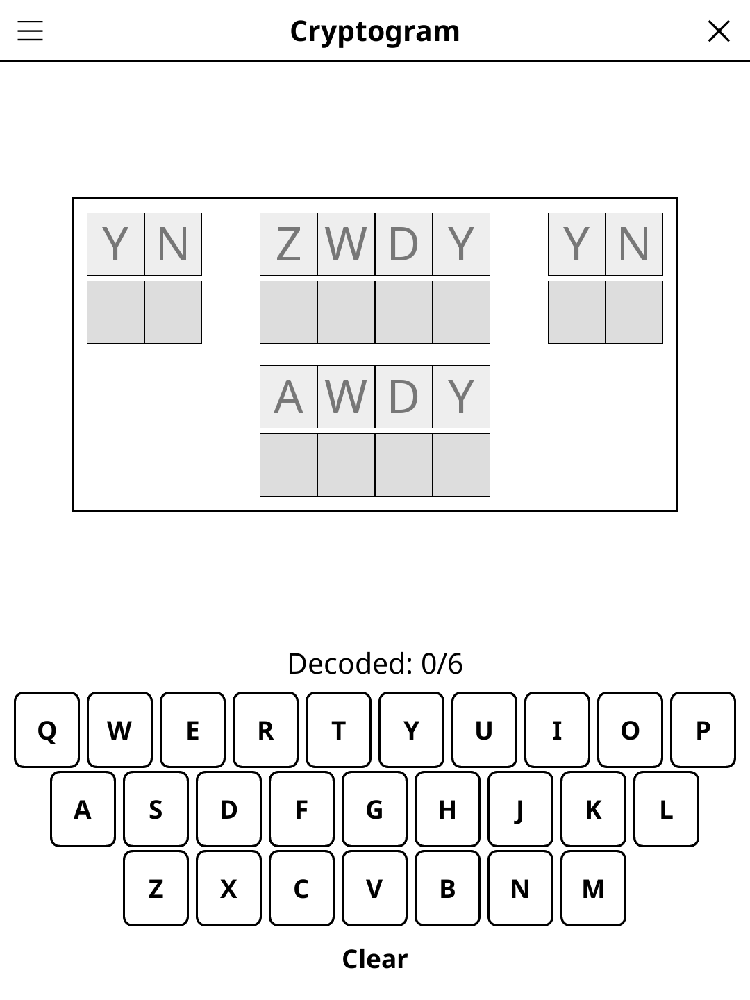

# cryptogram.koplugin

A Cryptogram puzzle plugin for [KOReader](https://github.com/koreader/koreader).

## Screenshot

## Rules

Decode an encrypted message by cracking its letter substitution cipher. Each letter has been replaced by another letter, consistently throughout the text. Tap an encrypted letter to select it, then type your guess. Use word patterns and letter frequency to deduce the full message.

## Features

- **Over 500 phrases per language (FR / EN)** — proverbs, famous quotations, film lines, book titles, songs and nursery rhymes; the source (author, work) is shown once a phrase is solved
- **No repeats** — a phrase only comes back once every other phrase of its language has been played, across sessions too
- **Auto-fill** — when a letter is identified, all its occurrences update instantly
- **Auto-save** — puzzle state saved and restored on next launch

## Installation

1. Download `cryptogram.koplugin.zip` from the [latest release](../../releases/latest).
2. Extract into the `plugins/` folder of your KOReader data directory.
3. Restart KOReader.
4. Open the menu → **Tools** → **Games** → **Cryptogram**.

## Controls

| Action | How |
|--------|-----|
| Select a cipher letter | Tap it |
| Assign a plain letter | Tap the keyboard |
| Erase an assignment | Type the same letter again |
| Erase every assignment | Tap **Clear** |
| New puzzle | Tap **New game** |
| Show rules | Tap **Rules** |

## Phrases

The phrases live in `data/phrases_fr.lua` and `data/phrases_en.lua` as
`{ text, source }` pairs: text in capitals without accents (letters, spaces,
apostrophes and hyphens), 12 to 64 characters. Only well-established
attributions are used; `test_phrases_spec.lua` checks the format and
duplicates.

## License

GPL-3.0 — see [LICENSE](LICENSE).
